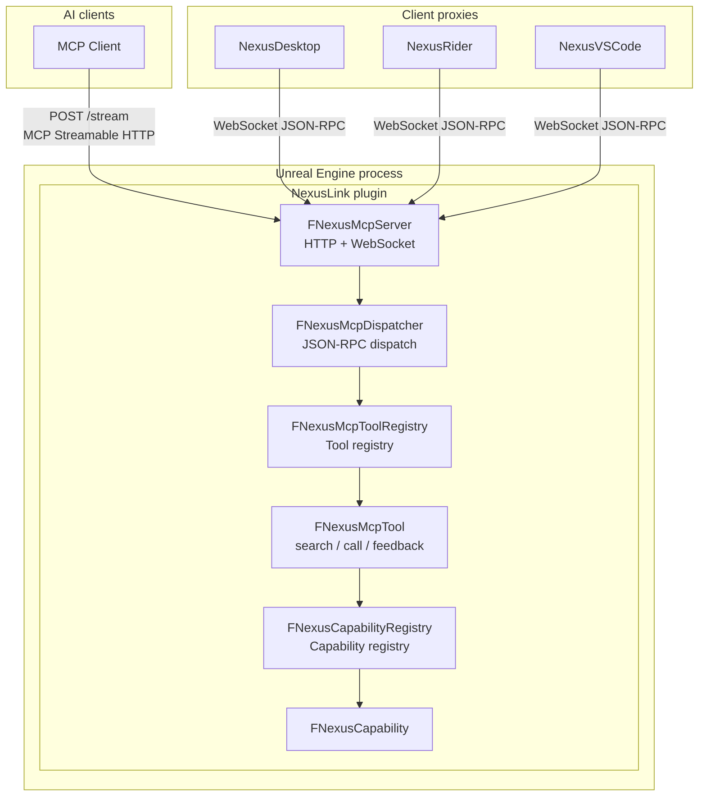
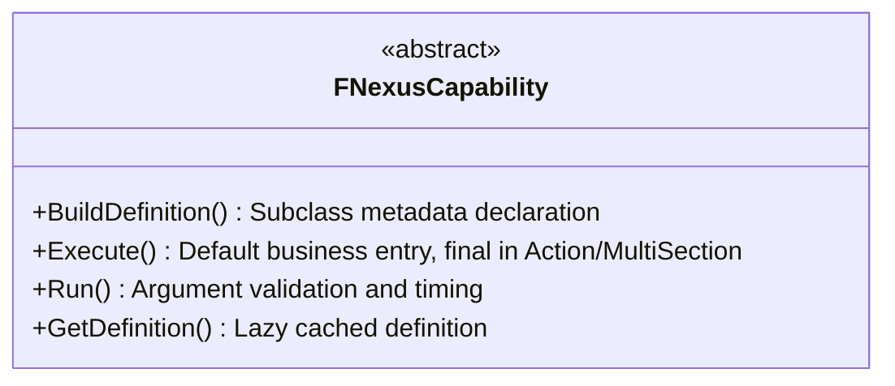
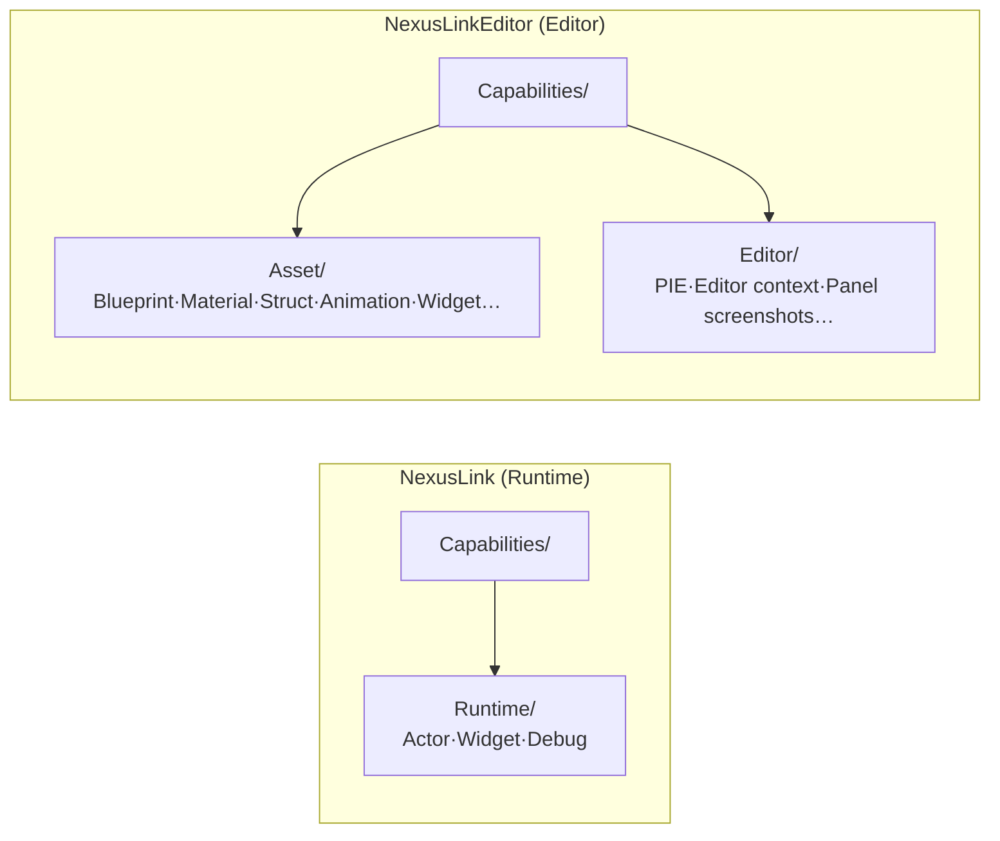
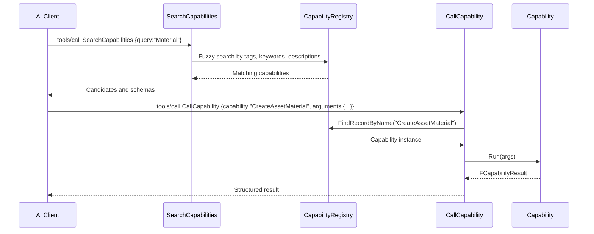
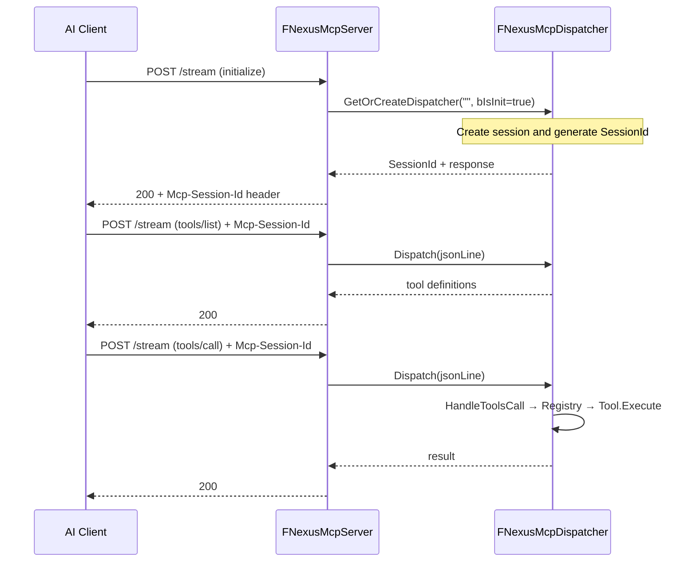
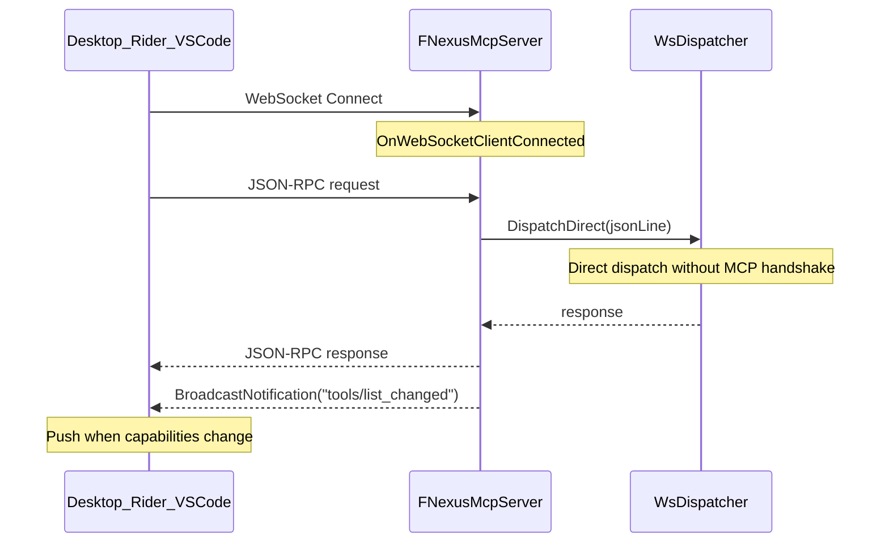

# NexusLink Architecture

**语言 / Language**: [简体中文](architecture.md) · **English**

[Documentation](README.en.md) · [Home](../README.en.md)

## System architecture



For ports and switch layers across all four routes, see [usage-guide §1](usage-guide.en.md#1-clients-and-switches). The authoritative capability catalog is `SearchCapabilities` / [tool-reference.md](tool-reference.md); do not maintain a hard-coded count here.

## MCP server lifecycle

`FNexusMcpActivation` (`NexusMcpActivation.h/.cpp`) resolves activation through the single desired-state decision point. Precedence is **console session override > `-EnableNexusMcp` launch argument > `UNexusLinkSettings::bEnableMcpServer` for trusted roles only > disabled by default**. Ports and LAN binding follow the same precedence through `ResolveListenConfig()`. Trusted roles satisfy `GIsEditor && !IsRunningCommandlet()`: editor-binary children launched with `-game`/`-server` and cook/commandlet processes do not read Preferences. They need explicit arguments or console commands, preventing inherited settings from starting competing MCP servers. **`NexusLink.Mcp on|off|status|restart|panel`** applies within the current session without writing to disk; see the debug panel below. `off` uses a tri-state override to prevent later unrelated Preferences changes from restarting the server.

`FNexusLinkModule::ApplyDesiredMcpState()` is the only application point that calls `TryStartMcpServer`/`StopMcpServer`, whether triggered by startup, Preferences changes, or console commands. It writes the result to transient read-only `UNexusLinkSettings::McpRuntimeStatus`, so the UI displays actual state/source instead of relying only on the checkbox. Cooked Game/DS additionally support **`-NexusMcpPort=`**, **`-NexusWsPort=`**, and **`-NexusAllowLan`** overrides.

The plugin has two modules. `NexusLink` (**`Type: Runtime`**, usable in cooked Game/DS) contains Server, Dispatcher, Registry, three meta-tools, and Runtime capabilities. `NexusLinkEditor` (**`Type: Editor`**, loaded only in editor binaries) contains Editor capabilities and settings/status UI. **`NEXUSLINK_WITH_SERVER`** (`!UE_BUILD_SHIPPING`) gates `REGISTER_MCP_TOOL` / `REGISTER_MCP_CAPABILITY`, removing the server and registries at compile time in Shipping. Platform gating uses both `PlatformAllowList` (UE5) and `WhitelistPlatforms` (UE4.2x). Settings/status UI register only when the editor module loads; MCP listeners can start in Development/DebugGame standalone Game/DS and editor-hosted `-server`. No `FNexusMcpServer` is created when disabled.

**Capability visibility:** full Editor hosts expose every enabled capability. Cooked Game/DS in Development/DebugGame expose only Runtime capabilities from `NexusLink` (`FNexusRuntimeCapability` / `FNexusRuntimeMultiSectionCapability`). Editor capabilities in `NexusLinkEditor` are neither compiled nor registered. Shipping has no server and exposes no capabilities.

**In-game debug panel:** `NexusLink.Mcp panel`, implemented in `Source/NexusLink/Private/UI/NexusMcpDebugOverlay.{h,cpp}` and `SNexusMcpDebugPanel.{h,cpp}`, shares Runtime-only Slate code between PIE and standalone Game/DS under the same `NEXUSLINK_WITH_SERVER` gate. It adds a viewport overlay through `UGameViewportClient::AddViewportWidgetContent`, without UMG assets or linking `NexusLinkEditor`. The MCP section reuses `FNexusMcpActivation` / `ApplyDesiredMcpState`. Capability display filters with `FNexusHostUtils::IsCapabilityVisibleOnHost`; toggles use `UNexusLinkSettings::SetSessionCapabilityEnabled` / `SessionDisabledCapabilities`, symmetric with `SessionEnabledCapabilities`. Precedence is session-disabled > session-enabled > dangerous-access mode > persistent `DisabledCapabilities`. All overrides are transient, never call `SaveConfig`, and expire with the process; `ClearSessionCapabilityOverrides()` restores persistent settings.

## Layer responsibilities

| Layer | Component | Responsibility |
|------|------|------|
| Network | `FNexusMcpServer` | HTTP/WebSocket server, connections and session isolation, controlled by `bEnableMcpServer` / `-EnableNexusMcp` |
| Protocol | `FNexusMcpDispatcher` | JSON-RPC 2.0 parsing, MCP handshake state machine, routing |
| Registry | `FNexusMcpToolRegistry` / `FNexusCapabilityRegistry` | Global singleton registries with O(1) name lookup |
| Tool | `FNexusMcpTool` | Three meta-tools: `SearchCapabilities` / `CallCapability` / `SubmitFeedback` |
| Capability | `FNexusCapability` | Atomic work units grouped by domain; plugin-gated capabilities depend on the host |

---

## Capability system

### Core abstraction



`FNexusActionCapability` / `FNexusMultiSectionCapability` declare `Execute` **final**; subclasses implement `RegisterActions` / `ExecuteSection`. Select the base using [CapabilitySpec](../Resources/CapabilitySpec.en.md) §2.1.1.

### Self-registration

```cpp
// Register with one line at the bottom of the .cpp
REGISTER_MCP_CAPABILITY(FNexusSearchAssetCapability);
```

The macro uses C++ static initialization to register an instance globally when its module loads. Adding a Capability requires only:

1. **Choose the module** using CapabilitySpec §2.1.0: live PIE/Game objects without disk saving use Runtime `NexusLink`; disk assets, editor APIs, and saving use `NexusLinkEditor`.
2. Create `.h/.cpp` files in a domain directory under that module's `Source/<module>/Private/Capabilities/`.
3. Select the base using CapabilitySpec §2.1.1. `manage_*` + `operations[]` uses `FNexusActionCapability`, with no `Execute` override; other cases follow the table. The selected module narrows the available bases. Implement the required hooks.
4. Add `REGISTER_MCP_CAPABILITY(ClassName)` at the bottom of the file.

No existing code needs modification.

### Domain directories

Both modules use the same `Private/Capabilities/` domain categories; grouping anchors omit module names. Optional-plugin capabilities live in [NexusLinkExt](https://github.com/bytepine/NexusLinkExt).



### Decoupled Tools and Capabilities



AI clients discover before calling instead of memorizing every capability name.

---

## Exposure modes (ToolsListMode)

Switch the two `tools/list` exposure modes in Editor Preferences → Plugins → NexusLink → Tools List Mode:

| Mode | tools/list | initialize.instructions | Use |
|------|----------------|-------------------------|---------|
| **SearchMode**, default | Three meta-tools | `InitializeInstructions.SearchMode.md`, concise routing and hard rules | Discover on demand through SearchCapabilities, reducing per-turn tool-list tokens |
| **MultiTool** | SubmitFeedback plus every enabled Capability as an individual MCP Tool | `InitializeInstructions.MultiTool.md`, concise global constraints | Clients that need to enumerate all capabilities at once |

Enabled extension plugins register matching instruction fragments through `FNexusInstructionRegistry`; handshakes append them by name. Unregistered fragments are not included.

MCP clients typically inject `tools/list` and `initialize.instructions` into the prompt **every model turn**. Approximate fixed overhead below uses the capabilities registered when measured, parsed source schemas, and characters÷4, excluding call results and conversation history:

| Component | SearchMode | MultiTool | Difference |
|---|---|---|---|
| tools/list | 3 tools · ~0.3k tokens | All enabled capabilities + SubmitFeedback · ~21.5k tokens | **+21.2k** |
| initialize.instructions | ~1.1k | ~0.7k | −0.4k |
| **Fixed total per turn** | **~1.4k** | **~21.9k** | **~15.6× / +20.5k** |

- SearchMode combines a small tool list and concise routing; each needed schema costs one discovery call.
- MultiTool has slightly shorter instructions but injects every capability schema each turn.
- Typical task totals, excluding identical call results: 1 search + 1 call costs approximately **4.6×**, 2 searches + 3 calls **5.5×**, and 4 searches + 8 calls **6.1×**. Even with no search and direct routed calls, fixed overhead remains approximately **15.6×**.

**Recommendation:** keep **SearchMode** for daily work and long conversations. Use MultiTool when clients cannot follow search→call or must enumerate every Tool at once, and disable irrelevant capabilities. With UE online, the host's `Script/measure_token_baseline.py` can remeasure live `tools/list`.

NexusLink automatically broadcasts `notifications/tools/list_changed` after mode or capability changes.

After connecting to UE, Desktop/Rider/VSCode fetch `InitializeInstructions.*.md` through `nexus/instructions` and `ProxyConfig.json` through `nexus/proxy_config`, including connection-tool descriptions, initialize prefixes, and errors. They append these to their own `initialize.instructions` / `tools/list` responses. Proxies also implement TTL caching, disconnected snapshots, write confirmation, and Pause; see [the session contract](proxy-session.en.md). Direct `:45000` connections do not have that layer.

---

## Message flow

### MCP Streamable HTTP



HTTP sessions are isolated by `Mcp-Session-Id`, supporting concurrent AI clients. At the configured concurrent-session limit, default 16 with 0 meaning unlimited, `GetOrCreateDispatcher` evicts the least recently active session by `LastActivityAt`, allowing new initialization. Later requests from evicted sessions use the existing 404 `SessionNotFound` behavior.

The HTTP receiving thread only copies request bodies/headers, then uses `AsyncTask` to enqueue on GameThread. Dispatch happens at the next `FCoreDelegates::OnBeginFrame`, before World Tick, before accessing `HttpSessions` / `Dispatch` / `DetectCurrentNetRole`. WebSocket and `GET /status` use the same queue. HTTP completes through deferred `OnComplete`; server shutdown rejects requests not yet executed.

Each frame start processes only a queue snapshot. Blueprint compilation, GC, or render waits may pump GameThread TaskGraph tasks; new requests then only enqueue for the next frame start, avoiding reentrancy inside Tick or another edit. `ManageAssetBlueprint` component operations do not fully compile each item; `bCompile` controls batch finalization. Final compilation skips GC while the outer transaction is active to retain Undo snapshots needed for rollback.

### Synchronous execution and known limits

`tools/call` runs synchronously on GameThread from `Dispatch`/`DispatchDirect` through `EmitToolResult`. Engine waits may pump other TaskGraph tasks but cannot reenter dispatch from the request queue. Blueprint compilation, asset saving, `FlushRenderingCommands` screenshots, and full asset scans may still cause frame hitches. Capabilities requiring staged execution should use the existing editor long-operation interfaces.

HTTP `/stream` uses stateless request/response with no SSE/chunked push channel. WebSocket can push through `BroadcastNotification`. The proxies handle `notifications/tools/list_changed` on their ordinary persistent connections; dedicated editor-operation request channels also support `notifications/progress` and cancellation notifications. Existing editor long operations return an `OperationId`; callers poll `GetEditorOperation` for state and results without relying on completion notifications. Synchronous capabilities keep the request pending until execution ends. Wrapping their outer requests asynchronously does not remove blocking engine work on GameThread.

Desktop/Rider/VSCode apply a 120s timeout to `tools/call` without retrying timeouts. Requests on one persistent connection also queue serially, so a slow call blocks subsequent requests in that session.

A timeout or disconnection after sending does not establish that UE did not execute, cancel, or roll back the call. For writes with uncertain outcomes, proxies retain the original `errorKind`, add `error.data.executionStatus="unknown"` and `retryable=false`, and invalidate old read caches; see the [proxy session contract](proxy-session.en.md#4-disconnection-continuity). When an `OperationId` is available, query the owned operation's terminal state before taking further action, and request cancellation only when allowed. For writes without an operation ID, read actual state before deciding what to do rather than automatically resending. This contract does not make every capability asynchronous; staged execution still requires the capability to use a supported long-operation interface.

Observability: when transport duration exceeds `SlowCallThresholdMs` (usage-guide §2.6), `LogToolCallDuration` in `NexusMcpDispatcher.cpp` logs Warning, covering end-to-end compression, TTL injection, and serialization. Capability-layer `SlowCall` feedback uses the same threshold, including slow calls that ultimately fail, marked `(error)` in Note. Proxy timeouts use `ProxyTimeout` separately.

### WebSocket proxy channel (Desktop / Rider / VSCode)



The WebSocket channel shares one `WsDispatcher`, avoiding stateful handshake overhead. All three clients use this channel.

---

## Server framework details

- **Write Undo:** `FNexusEditorTransaction` wraps in-memory Execute for one `Run`; `CallCapability.Calls[]` with at least two entries adds an outer transaction. Business-item, section, and automatic-compilation errors count as failure, triggering attempted Apply then Cancel and skipping autosave. Compile automatically only after all business operations pass; commit the in-memory transaction only after all compiles pass, then execute `bSaveToDisk`. Save failures return explicit errors without promising disk atomicity. Explicit package operations/runtime effects are not rolled back; a single manage call's partial failure retains successful operations.
- **Errors:** `FCapabilityResult::HasErrors()` aggregates business/finalization errors. SearchMode/MultiTool return `isError=true` while retaining structured details. Reading an asset's own `bHasCompilerErrors` state is not itself a failed read.
- **Repeated-read hints:** `RedundantCall` counts successful All reads only. Subsection calls still return current data; writes clear read hints, without process-global records blocking other sessions.
- **MCP Streamable HTTP:** `POST /stream`, stateless `GET /status` probing, and per-session `Mcp-Session-Id`.
- **WebSocket:** defaults from port 55000; supports `nexus/instructions` and `nexus/proxy_config`.
- **Capabilities and responses:** per-capability enable/disable, `*_defaults` compression, memory high-water batch eviction through `FNexusPackageLedger`, and SearchAsset `RecommendedGet` / `RecommendedManage`.
- See [usage-guide §2.6](usage-guide.en.md#26-settings-and-feedback) for settings and the feedback workflow.

---

## Cross-version compatibility

### Principles

NexusLink supports UE 4.26 through 5.8+. Compatibility uses semantic macros defined in `NexusVersionCompat.h`.

### Mechanism

```cpp
// Numeric engine version
#define NX_UE_VERSION       (ENGINE_MAJOR_VERSION * 100 + ENGINE_MINOR_VERSION)
#define NX_UE_AT_LEAST(M,m) (NX_UE_VERSION >= (M) * 100 + (m))

// Semantic aliases named after API changes
#define NX_UE_HAS_FTSTICKER            NX_UE_AT_LEAST(5, 0)
#define NX_UE_HAS_CLASS_PATHS          NX_UE_AT_LEAST(5, 1)
// See docs/version-compat-reference.md for more
```

### Rules

- **Do not** use `ENGINE_MAJOR_VERSION` / `ENGINE_MINOR_VERSION` directly in business code.
- **Reuse or add** semantic `NX_*` macros.
- When adding a macro, document its UE version and API change in comments at the top of `NexusVersionCompat.h`.
- See [the macro reference](version-compat-reference.en.md) for the full table.
