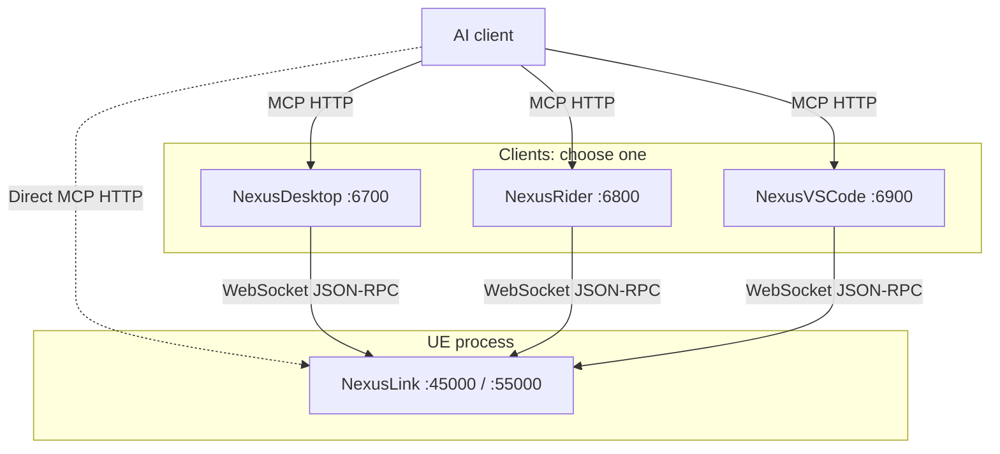

# NexusLink Usage Guide

**语言 / Language**: [简体中文](usage-guide.md) · **English**

[Input, performance, and UI diagnostics](runtime-diagnostics.en.md) covers busy-request rejection, player input, live timings, CSV, UMG property origins, and optional CommonUI.

[Independent engine backends](toolset-backends.en.md) explains direct engine API calls. NexusLink itself does not directly link to or call official Toolsets/Registry and needs no official MCP server. Standard domain-plugin dependencies follow engine requirements; for example, UE 5.9 PCG must retain Registry.

[Editor compatibility extensions](editor-compatibility.en.md) covers version boundaries and invocation for parameters/UMG, mesh generation, scene organization, and Blueprint graph editing.

[Animation and domain actions](animation-niagara-gamefeatures-toolsets.en.md) covers Sequencer / Control Rig, deep Niagara writes, Game Features, and NexusLink-owned action discovery.

[Editor tools](editor-toolsets.en.md) also covers advanced Slate operations, UMG structure, PCG execution/sampling, Niagara diagnostics and explicit fixes, semantic search, project skills, settings, and plugin discovery. Screenshots include standard MCP image blocks by default; pass `bIncludeImage=false` for disk paths only. Domain capabilities require their actual domain plugins to be enabled and rebuilt; semantic search requires SemanticSearch indexing and Embedding configuration.

[Documentation](README.en.md) · [Home](../README.en.md)

For end users: install the UE plugin, choose a client, enable the required switches, and configure authentication. See [the tool reference](tool-reference.md) ([Chinese](tool-reference.zh.md)) for Capability parameters and [architecture](architecture.en.md) for design.

This guide applies to any UE 4.26+ project. If the plugin is integrated already, enable MCP directly. Screenshots illustrate UI locations; version numbers, project names, and old snake_case tool names are examples. Follow the actual tool/parameter list returned by your connection; this guide uses current PascalCase names.

For PCG tuning, PhysicsAsset editing, GameplayTags configuration, and DataRegistry prerequisites, see [parameters and project data](pcg-physics-tags-dataregistry.en.md). Tag management writes configuration immediately through engine editors; the topic explains permissions and rollback boundaries.

## Contents

- [Upgrade from 1.x](#0-upgrade-from-1x-to-20)
- [Clients and switches](#1-clients-and-switches): [authentication](#11-authentication), [remote access](#12-remote-access-explicit-ips-no-subnet-scanning)
- [UE plugin](#2-nexuslink-ue-plugin): [installation](#21-installation), [enable server](#22-enable-mcp-server-required), [debug panel](#24-in-game-debug-panel-pie--standalone), [dangerous capabilities](#210-dangerous-capabilities-and-scripts)
- [NexusDesktop](#3-nexusdesktop) / [NexusRider](#4-nexusrider) / [NexusVSCode](#5-nexusvscode)
- [FAQ](#6-faq)

## Quick start (NexusDesktop recommended)

For first setup, follow [the project quick start](../README.en.md#quick-start). This guide provides detailed settings/troubleshooting. See [§3](#3-nexusdesktop) for NexusDesktop screenshots and [§1](#1-clients-and-switches) for other routes.

> **Security:** tokens are credentials. Do not commit them, paste them into public documentation, or expose them in screenshots. Writes modify real assets or runtime state; review version-control changes before committing.

Editor/PIE and standalone Game/DS use different activation methods; see [§2.2](#22-enable-mcp-server-required). For asset previews, UMG interaction, editor automation, or diagnostic retests after connection, see [workflow topics](README.en.md).

---

<a id="0-从-1x-升级到-20"></a>
## 0. Upgrade from 1.x to 2.0

Version 2.0 has two incompatible changes:

**1. Authentication is enabled by default; upgrade all four components together.** A 1.x relay does not send the first WebSocket `auth` frame and cannot connect to authenticated UE 2.0. Upgrade the UE plugin and NexusDesktop/Rider/VSCode together to 2.x. If a partial upgrade is unavoidable, temporarily disable UE MCP Authentication, then complete the upgrade.

**2. All MCP/AI-visible text is English.** Capability descriptions, errors, AIRules, and similar text changed to English; source comments, settings, and UE_LOG remain Chinese. Update custom scripts/prompts that depend on Chinese error strings.

Other upgrade notes:

- **Direct UE AI configuration requires Bearer:** copy the MCP Authentication Token from UE settings; see [§1.1](#11-authentication). A local relay connecting to local UE needs no extra configuration.
- **Extra tokens changed from one comma-separated line to individual entries:** upgrade splits existing values automatically. If no valid token can be parsed, preserve the original value and log a warning instead of silently clearing it.
- **Dangerous capabilities are disabled by default:** settings record names without overriding manually enabled entries. Existing enabled dangerous capabilities migrate to custom enablement. See [§2.10](#210-dangerous-capabilities-and-scripts) for modes/session overrides.
- **Projects that used 2.0.0-beta:** beta wrote the global `[HTTPServer.Listeners] DefaultBindAddress` key into Engine.ini. Stable versions write only the port's ListenerOverrides; startup warns about leftover global keys, which can be removed manually.

---

## 1. Clients and switches



| Route | Endpoint | Use |
|------|------|------|
| **[NexusDesktop](https://github.com/bytepine/NexusDesktop)**, recommended | `http://127.0.0.1:6700/stream` | Standalone tray app without IDE extensions |
| **[NexusRider](https://github.com/bytepine/NexusRider)** | `http://127.0.0.1:6800/stream` | JetBrains Rider |
| **[NexusVSCode](https://github.com/bytepine/NexusVSCode)** | `http://127.0.0.1:6900/stream` | VSCode / Cursor / CodeBuddy / Windsurf |
| **Direct UE** | `http://127.0.0.1:45000/stream` | No proxy; choose the UE port yourself |

NexusLink in UE supplies capabilities. Clients provide discovery, forwarding, and [the proxy session layer](proxy-session.en.md): TTL caches, read snapshots when the editor is unreachable, write confirmation, and Pause. Direct UE has no session layer.

| Route | Required switches/configuration |
|------|--------|
| Direct UE | **One layer:** UE Enable MCP Server and AI endpoint `:45000` |
| NexusDesktop | **Two layers:** UE Enable MCP Server, tray Enable Relay Server (off for new installations), and AI endpoint `:6700` |
| Rider / VSCode | **Three layers:** UE Enable MCP Server, IDE proxy enabled, and AI endpoint `:6800` / `:6900` |

Every required layer must be enabled. Port collisions advance automatically to the next port; use the actual port shown by the UI.

Run one local proxy only; do not run Desktop `:6700`, Rider `:6800`, and VSCode `:6900` simultaneously. Otherwise they scan repeatedly and connect independently to the same UE.

Servers bind loopback by default and reject browser requests carrying Origin. ExecCommand / ExecPython are disabled by default; see dangerous-capability access modes.

<a id="11-身份验证"></a>
### 1.1 Authentication

> Treat tokens as credentials: do not commit mcp.json, paste complete tokens into public documentation, or expose them in screenshots. Redact logs/screenshots before sharing.

All four components share one persistent token file per machine:

| System | Path |
|------|------|
| Windows | `%LOCALAPPDATA%\NexusLink\mcp-auth-token` |
| macOS | `~/Library/Application Support/NexusLink/mcp-auth-token` |
| Linux | `~/.config/NexusLink/mcp-auth-token` |
| Android | `<application-internal-files>/NexusLink/mcp-auth-token` |
| iOS | `<ProjectSavedDir>/NexusLink/mcp-auth-token` |

Mobile platforms use application-specific directories and do not share token files with desktop proxies; Android uses internal application storage.

`GET /status` probes availability and **never contains the token**. A local proxy reads the shared file and `{Temp}/NexusLink/{PID}.json` automatically when connecting to local UE; **remoteUnreal is unnecessary**.

Discovery/authentication retain original protocol spellings such as server, wsPort, authRequired, params.token, and result.ok. Capability PascalCase naming does not apply to these fields.

| Switch | Location | Default | When disabled |
|------|------|------|--------|
| **MCP Authentication** | UE Editor Preferences | On | HTTP/WS do not validate tokens; /status.authRequired=false, like older plugins |
| **Require MCP Authentication** | Desktop / Rider / VSCode | On | AI needs no Bearer for that relay; UE connections still follow the peer's /status.authRequired |

The switches are independent:

| Relay / UE | UE authentication on | UE authentication off / old UE |
|-----------|-----------|---------------------|
| **Relay authentication on** | AI needs Bearer; relay sends WS auth | AI needs Bearer; skip WS auth |
| **Relay authentication off** | AI needs no Bearer; relay still sends WS auth | Neither side authenticates |
| **Old 1.x relay** | **Cannot connect:** no first-frame auth; upgrade the relay or temporarily disable UE authentication | Neither side authenticates |

For multiple machines/tokens:

- Add Extra Authentication Tokens individually in UE/Desktop/Rider; VSCode uses the extraAuthTokens array. The local token always remains valid.
- AI mcp.json accepts `"Authorization": "Bearer <tok1>, <tok2>"`; matching any token is sufficient.
- Remote UE uses `host:McpPort [token...]`; omit inline tokens when using the extra-token list.

<a id="12-跨机显式-ip不扫网段"></a>
### 1.2 Remote access: explicit IPs, no subnet scanning

Copy remote configuration from **the serving endpoint**, choose its correct network-adapter IP, then paste on the other side. Generated Bearer includes **only that machine's token**, never its extra tokens.

1. **UE:** enable Allow LAN Binding to bind HTTP to 0.0.0.0 and permit inbound traffic through the system firewall. Do not forward ports publicly. Select an adapter and Copy Remote Connection to obtain AI mcp.json, a relay remoteUnreal line, and a VSCode remoteUnreal entry. Tokens can be copied before MCP starts; the provisional port is 45000, so check the actual title-bar port.
2. **Relay → UE:** local UE needs no configuration. Paste the remote line into remoteUnreal, or omit its token and add it under Extra Authentication Tokens. Only these addresses' /status endpoints are probed.
3. **AI → relay:** enable listenLan / Allow LAN and Copy MCP Client Configuration, selecting an IP first with multiple adapters. Use the relay machine's local token in Bearer.

Enabling LAN while disabling authentication prompts for confirmation because any same-network machine could control the editor.

**WebSocket binding on `:55000` depends on engine version:** UE 5.2+ follows Allow LAN Binding, choosing 127.0.0.1 or 0.0.0.0. UE 4.26–5.1 cannot specify a binding address and always listen on all adapters, relying on first-frame auth. **Keep MCP Authentication enabled on these versions**; otherwise startup logs Error.

```json
{
  "mcpServers": {
    "nexus-unreal": {
      "url": "http://192.168.1.20:6900/stream",
      "headers": { "Authorization": "Bearer <relay-machine-token>" }
    }
  }
}
```

VSCode remote entries, also available through UE Copy Remote Connection:

```json
"nexusMcp.listenLan": true,
"nexusMcp.extraAuthTokens": ["<other-machine-token>"],
"nexusMcp.remoteUnreal": [
  { "host": "192.168.1.30", "McpPort": 45000, "AuthToken": "<UE-machine-token>" }
]
```

Each Rider/Desktop remote-list line is `192.168.1.30:45000` or `192.168.1.30:45000 <token>`.

---

## 2. NexusLink (UE plugin)

<a id="21-安装"></a>
### 2.1 Installation

1. Download nexus-mcp-unreal-*.zip from [NexusLink Releases](https://github.com/bytepine/NexusLink/releases) and extract to your project's Plugins/NexusLink.
2. Enable the plugin under **Edit → Plugins → Developer → NexusLink**.
3. Restart the editor.

`Plugins/NexusLink/NexusLink.uplugin` should exist directly after extraction. Enabling the plugin does not start MCP; configure the server switch next.

Plugin installers exclude Python command-line tools. For GAS/BehaviorTree retests or Trace comparisons, download **Source code (zip / tar.gz)** from the matching Release and run from the extracted source repository's tools/ directory. These tools need not be installed under project Plugins/.

<a id="可选安装-nexuslinkextunlua"></a>
#### Optional: NexusLinkExt (UnLua)

For Blueprint Lua binding or runtime Lua debugging, install [NexusLinkExt](https://github.com/bytepine/NexusLinkExt):

1. Download nexus-mcp-ext-*.zip from [Releases](https://github.com/bytepine/NexusLinkExt/releases) and place its NexusLinkExt/ directory under project Plugins/.
2. Install/enable **UnLua**, enable NexusLinkExt in .uproject, and restart the editor.
3. Search for lua using SearchCapabilities to verify registration; these capabilities do not register without UnLua.

HotReloadRuntimeLua requires UnLua 2.x. EvalRuntimeLua and DofileRuntimeLua are disabled by default; manage their access in NexusLink dangerous-capability settings.

The plugin has NexusLink (**Type: Runtime**) and NexusLinkEditor (**Type: Editor**, loaded only in editor binaries) modules. **MCP runs in Editor/PIE, editor-hosted -server, and Development/DebugGame standalone Game/DS**. Shipping excludes the server at compile time.

Shipping module startup/shutdown install no MCP log capture, console commands, or initialization callbacks; they do not read/write authentication tokens, normalize token settings, or enumerate adapters. Extensions do not read instruction files either. Enable arguments cannot start MCP in Shipping.

### 2.2 Enable MCP Server (required)

MCP HTTP/WebSocket listeners are **off by default**. Activation resolves three sources with precedence **console > launch arguments > Preferences checkbox**. Preferences apply only to editor processes outside commandlets:

| Host | Activation | Persistence | Reads Preferences? |
|---|---|---|---|
| Editor including PIE | Preferences or runtime console; use NexusLink.Mcp panel during PIE | Checkbox persists; console/panel are session-only | Yes |
| Editor binary with -server, DS mode | Explicit -EnableNexusMcp; no viewport, so use status instead of panel | No | **No**, never inherits the checkbox |
| Editor binary with -game | Explicit -EnableNexusMcp or console; panel when a viewport exists | No | **No**, never inherits the checkbox |
| Development/DebugGame standalone Game/DS | -EnableNexusMcp or console; Game supports panel after ~, DS uses status | No | **No** |
| Cook / commandlet | -EnableNexusMcp | No | **No** |
| Shipping | Unavailable, excluded at compile time | — | — |

Other roles do not read Preferences, preventing child processes from inheriting the checkbox, starting competing servers, consuming ports, and complicating instance selection.

**Method A — settings, persistent for Editor roles only**

1. Open **Edit → Editor Preferences → Plugins → NexusLink**.
2. Under Server, check **Enable MCP Server**. The read-only Runtime Status below shows actual state and the effective source live.
3. Saving takes effect immediately. Unchecking stops HTTP/WebSocket and unregisters the instance immediately.

**Method B — launch arguments, process-only without disk writes, any role**

```bat
UE4Editor.exe YourProject.uproject -EnableNexusMcp
YourGame.exe -log -EnableNexusMcp
UnrealEditor.exe YourProject.uproject -server -EnableNexusMcp
```

Append -EnableNexusMcp to existing arguments, retaining -log, -server, and others. New processes do not inherit editor Preferences. In NexusDesktop Select UE Instance, choose the Game/DS by process, PID, or port. This argument has no effect in Shipping.

Optional: `-NexusMcpPort=45000` `-NexusWsPort=55000` `-NexusAllowLan`.

**Method C — console, process-only without disk writes**

Use editor Output Log or press ~ in a standalone Game:

```text
NexusLink.Mcp on                              ; Enable, like -EnableNexusMcp
NexusLink.Mcp on Port=45001 Lan=1             ; Override port and allow LAN
NexusLink.Mcp on -NexusMcpPort=45001 -NexusAllowLan
NexusLink.Mcp off                             ; Disable, overriding later unrelated Preferences changes
NexusLink.Mcp status                          ; State, addresses, auth, effective source / disabled reason
NexusLink.Mcp restart                         ; Restart with current effective overrides
NexusLink.Mcp panel                           ; Toggle the in-game panel in PIE / standalone
NexusLink.Mcp panel on|off                    ; Explicit panel state
```

Console has highest precedence. off prevents later arbitrary Preferences changes from restarting the service until on is issued or the user explicitly rechecks the Preferences switch.

### 2.3 Verify runtime state

- **Editor title bar, right side**, beside FPS/memory/objects, displays MCP/WS ports by default while MCP runs.
- The Preferences Runtime Status field shows actual running/stopped state, effective source, and reasons for not starting.
- NexusLink.Mcp status additionally shows bind addresses and authentication state.
- The in-game panel in PIE/standalone Game displays runtime information and session capability toggles; see [§2.4](#24-in-game-debug-panel-pie--standalone).
- Output Log reports server startup or why MCP is not enabled.

C++ callers can include NexusLinkSettings.h and call UNexusLinkSettings::IsMcpEnabled(), with their module depending on NexusLink. Blueprints have the pure **Is Mcp Enabled** node under NexusLink|MCP. It reports actual runtime state after resolving launch arguments, console, and Preferences. It returns false before startup, after failure, and in Shipping; querying does not load the module or start the service.

### 2.4 In-game debug panel (PIE / standalone)

Open the console with ~ and run NexusLink.Mcp panel, panel on, or panel off. This Slate viewport overlay needs no UMG assets and is excluded from Shipping:

- **MCP information:** runtime state, effective source, listen addresses, and authentication. Start/Stop/Restart reuse FNexusMcpActivation session overrides, like console on/off/Restart.
- **Capabilities:** filter by host visibility, showing Runtime only in standalone and Editor+Runtime in PIE Editor hosts. Group by source directory, collapse groups, and filter names/descriptions.
- Each checkbox is a **temporary session override**. It does not write DisabledCapabilities or call SaveConfig and expires when the process exits. Clear Session Overrides restores persistent Preferences.
- Close or Esc dismisses the panel. While open it temporarily uses FInputModeGameAndUI and shows the cursor, restoring previous state where possible afterward.

Preferences dangerous-access mode itself stays unchanged. A panel checkbox is a **single-capability session override**: even Disabled mode can temporarily enable one item, equivalent to a one-item -NexusEnableDangerousCaps override. Other dangerous capabilities and INI settings stay untouched. Process exit or Clear Session Overrides restores persistent behavior.


<a id="241-独立-game--ds-mcp-debug-清单"></a>
### 2.4.1 Standalone Game / DS debugging checklist

Development/DebugGame standalone Game loads only NexusLink Runtime. Its catalog has **no Editor capabilities** such as ControlPie, GetEditorContext, or SearchAsset. Use these Runtime-registered capabilities:

Dedicated Servers also support runtime logs, Actors, animation, AI, and GAS, but have no viewport or UMG. They cannot use panel, viewport screenshots, or Widget tools; check status with NexusLink.Mcp status.

| Intent | Capability | Notes |
|------|------------|------|
| Read Output Log | GetOutputLog, Preset=diagnose | The ring buffer lives in Runtime and is directly readable in standalone; identical consecutive lines merge as Repeat |
| Observe only the next operation | GetOutputLog Watch, followed by bCollectWatch=true | Session side buffer, no configuration writes; Warning must also match filters |
| Narrow capture | SetLogCaptureFilter | Persistent category allowlist writes configuration; Warning/Error are always captured |
| Console commands | ExecCommand | GEngine->Exec; **Dangerous**, absent from the default catalog |
| Viewport screenshots | CaptureViewport | Target=pie selects Game viewport; Editor/EditorDesktop select top-level windows. Panel tabs and ViewAngle are editor-only |
| Locate objects | ListRuntimeActors / ListRuntimeWidgets | ClassFilter / NameFilter / TagFilter |
| Inspect Actor state | GetRuntimeActorProperty | Diagnose=visibility\|transform\|WorldTransform\|defaults; use SetRuntimeActorProperty for writes, then read back |
| Animation / AI / GAS | GetRuntimeActorAnimation / _behavior_tree / _ability_system | Use the corresponding interact_* for writes |
| UnLua | Outside this plugin | Install NexusLinkExt, then search for get_runtime_lua_* / EvalRuntimeLua |

**Dangerous capabilities** ExecCommand / ExecPython default to DangerousCapAccess=Disabled. Standalone **Confirm mode has no editor dialog** and denies execution. Enable a capability through the panel's session checkbox, custom Preferences enablement, or -NexusEnableDangerousCaps.

Example flows: invisible Actor → ListRuntimeActors → GetRuntimeActorProperty Diagnose=visibility|transform; existing error → GetOutputLog Preset=diagnose; next-operation logs → Watch followed by bCollectWatch=true; screenshot → CaptureViewport Target=pie, optionally preflight with bValidateOnly=true.

### 2.4.2 Read Unreal Insights (Editor, UE 4.26+)

UE4 Store analyzes streams directly by TraceId, returns empty TracePath, and creates no cache files. Summary fields unavailable on older engines are omitted; other arguments, default Sections, and meanings remain the same.

These two capabilities are unavailable in standalone Game/DS. Read only stopped, closed .utrace files; never tail an actively growing trace. On UE5, record with `Trace.File <path> cpu,frame,bookmark`, then `Trace.Stop`. On UE4, launch with `-trace=cpu,frame,bookmark -tracefile=<path>` and read after process exit; UE4 Trace.Stop disables channels without closing the file connection.

| Intent | Capability | Notes |
|------|------------|------|
| Find recent traces | ListTraces | Lists Saved/Profiling and the local Trace Store without opening files. Pass nonempty Path as GetTrace.TracePath; UE4 Store paths are empty, so pass TraceId |
| Inspect hitches | GetTrace Summary + Frames | Counts, average, P95, and slowest frames; missing frame channels return an error |
| Inspect CPU in that frame | Timers + Bookmarks with the hitch frame's StartTime/EndTime | Without an explicit window, Timers uses the slowest Game frame. Retry when bAnalysisComplete=false |

### 2.5 Ports

- Default MCP HTTP is 45000 and WebSocket 55000. Override starting ports with -NexusMcpPort= / -NexusWsPort= or console Port= / WsPort=.
- Collisions advance to the next available port; settings display actual ports read-only.
- Show Ports in Status Bar can be toggled and is **on by default**.

### 2.6 Settings and feedback

Open **Edit → Editor Preferences → Plugins → NexusLink**. Feedback stays local under `<ProjectRoot>/.nexus-feedback/`; nothing is sent over the network.

| Setting | Meaning |
|------|------|
| Plugin information | Current version, Check for Updates, and automatic startup checks, enabled by default |
| Enable MCP Server | Master switch, **off by default** |
| MCP Authentication | On by default; disabling skips HTTP/WS token validation, matching older versions |
| MCP Authentication Token | Machine-unique; Copy copies only the token. Copy Remote Connection lets you select an adapter and generates mcp.json / remoteUnreal; available before MCP starts |
| Extra Authentication Tokens | Add other machines' tokens with +; do not add the local token again |
| Maximum concurrent sessions | Default 16; 0 is unlimited. Evict the least recently active HTTP session at capacity |
| Tools List Mode | SearchMode by default with three meta-tools, or MultiTool with individual Capability tools |
| Capabilities | Grouped/collapsed by directory; enable/disable groups or items |
| Enable Feedback Capture | Master switch; disabling discards automatic and manual feedback |
| Feedback Issue Repository | GitHub owner/repo used to prefill Create GitHub Issue |
| Search Overflow Threshold / Maximum Search Results | Control SearchOverflow and returned-result limits |
| Slow Call Threshold (ms) | Record SlowCall, including ultimately failed calls, and drive transport slow-call warnings |
| Compress Response Defaults | Extract repeated JSON fields into *_defaults; omitted fields imply defaults |
| Automatically Unload Read Packages | Unload batches after read-only thresholds, enabled by default |
| Package-count threshold / Memory high-water mark (MB) | Defaults: 16 packages / 1024 MB |

The console-row actions are **Open Directory / Export Markdown / Create GitHub Issue**. Keep packages after batch reads with CallCapability bKeepLoaded=true; release immediately through UnloadAsset.

Exported reports include Other comments and structured errors, normalize old category spellings before comparing trends, count average search hits only for records with numeric values, and attach redacted argument summaries to slow calls. Issue drafts prefer feedback containing actual errors.

Dangerous-capability access modes are on the same page; see [§2.10](#210-dangerous-capabilities-and-scripts). See [SubmitFeedback](tool-reference.md#submitfeedback) for automatic instrumentation and schema.

### 2.7 Direct UE connection

Complete [§2.2](#22-enable-mcp-server-required), then configure the AI client.

**Cursor**, `~/.cursor/mcp.json`:

```json
{
  "mcpServers": {
    "nexus-link": {
      "url": "http://127.0.0.1:45000/stream",
      "headers": {
        "Authorization": "Bearer <token>"
      }
    }
  }
}
```

Copy the token beside **MCP Authentication Token** in settings. Multiple values may be comma-separated; alternatively add the other endpoint's token under Extra Authentication Tokens. Never infer it from GET /status. See [§1.1](#11-authentication).

**CodeBuddy / Windsurf**:

```json
"nexus-link": {
  "url": "http://127.0.0.1:45000/stream",
  "transportType": "streamable-http",
  "headers": {
    "Authorization": "Bearer <token>"
  }
}
```

If ports advance automatically, use the editor title bar/settings value.

### 2.8 Tool model (SearchMode)

- **Three meta-tools:** SearchCapabilities, CallCapability, SubmitFeedback. Never pass a meta-tool name as Capability.
- **Capabilities:** atomic work units filtered by host plugins and engine version; see [the full reference](tool-reference.md).
- **SearchMode**, default: tools/list returns three meta-tools; SearchCapabilities precedes CallCapability. Recommended for daily use and long conversations.
- **MultiTool:** every enabled capability is an independent Tool. Use only when the client must enumerate all Tools at once. See [exposure modes](architecture.en.md#exposure-modes-toolslistmode).

Read assets through SearchAsset with AssetType + PathFilter, then use returned assets[].path and RecommendedGet / RecommendedManage. [InitializeInstructions.SearchMode](../Resources/InitializeInstructions.SearchMode.md) and [CapabilitySpec](../Resources/CapabilitySpec.en.md) define arguments and breaking key changes.

<a id="29-挂载-airules"></a>
### 2.9 Install AIRules

Plugin [AIRules.mdc](../Resources/AIRules.mdc) is **not injected through MCP**. Copy it to the game project's IDE Rules to complement handshake instructions:

1. Copy Resources/AIRules.mdc to game-project .cursor/rules/nexuslink-workflow.mdc.
2. Fill default PathFilter prefixes in the copy's project-specific section.
3. After plugin upgrades, diff AIRules.mdc and merge generic sections into your copy.

Do not duplicate the Capability routing table in AIRules; InitializeInstructions.SearchMode.md is authoritative.

<a id="210-危险-capability-与脚本执行"></a>
### 2.10 Dangerous capabilities and scripts

**Only arbitrary-code-execution entry points receive Dangerous**, including unrestricted console commands and scripts. They are **disabled by default**. Manage them under **Editor Preferences → Plugins → NexusLink → Dangerous Capabilities → Access Mode**:

| Mode | Behavior |
|------|------|
| **Disabled**, default | Search reports disabled and calls fail; retain capability-tree checkboxes but disable editing them |
| **Confirm every call** | Retain editable checkboxes; checked capabilities can be discovered/called, with an editor confirmation before each execution |
| **Custom enablement** | Check individual capabilities; enabled items run without prompts |

Confirm mode requires Reason describing purpose, expected effects, and why a safer dedicated capability is unavailable. Approval applies only to that request. Denial returns ErrorKind=UserDenied; do not retry. A default 90s timeout denies automatically. If fullscreen PIE hides the prompt, leave immersive mode first. Standalone Game/DS have no editor dialog and deny Confirm-mode execution.

SearchCapabilities returns TtlSeconds=0 and always queries live UE. If exact search still reports disabled, inspect AccessStateSource=UE, DangerousCapAccess, bExplicitlyDisabled, and bSessionDisabled to distinguish access mode, individual disablement, and temporary session disablement.

-NexusEnableDangerousCaps enables all currently registered dangerous capabilities for the session, overriding access mode without saving settings. The debug panel can enable one temporarily; see [§2.4](#24-in-game-debug-panel-pie--standalone).


**Script entry points and prerequisites:**

- ExecCommand runs UE console commands and captures output.
- ExecPython runs editor Python in Exec / File / Eval modes, returning stdout and traceback; the host must enable **Python Editor Script Plugin**.
- NexusLinkExt EvalRuntimeLua / DofileRuntimeLua are also disabled by default; see [installation](#optional-nexuslinkext-unlua).

Dedicated UI input, test control, compilation, and configuration capabilities are not dangerous solely because they write or have irreversible effects. Their argument, host, transaction, and long-operation limits still apply; see [editor tools](editor-toolsets.en.md). Existing individual disablement is preserved.

For checking whether unreal.* APIs exist, prefer read-only GetPythonApi, enabled by default. It also needs the Python plugin but embeds only allowlist-validated arguments into a fixed inspect script and accepts no user code.

**Why scripts are disabled by default:** Python can read/write files and launch subprocesses, equivalent to arbitrary execution inside the process. Scripts can bypass dedicated capability enablement and access wrong threads, invalid objects, or GC paths that crash the editor. Free-form scripts must handle engine-version differences, errors, and output size themselves.

Dedicated capabilities validate schemas, return structured results, and record transactions for supported write paths. Scripts permit arbitrary branches, loops, and side effects. Even though ExecPython starts a transaction, direct assignment and package operations may not be undoable, and bUndoRecorded=true does not promise complete Undo. See [Python Undo](#execpython-undo-and-bundorecorded) and [write/rollback boundaries](#property-changes-are-not-visible-in-ue-or-on-disk).

Search for dedicated capabilities first. Use scripts only when the capability is missing, branching/looping batches are needed, or diagnosing capabilities themselves. Report missing capabilities through SubmitFeedback and disable temporary permission afterward.

---

## 3. NexusDesktop

A standalone tray application with **no IDE extension required**. Default port: 6700.

### 3.1 Install and enable the relay

1. Download from [NexusDesktop Releases](https://github.com/bytepine/NexusDesktop/releases): Windows NexusDesktop-windows-amd64-v<version>-setup.exe or macOS NexusDesktop-darwin-arm64.dmg, Apple Silicon only. Do not download *-update.zip, which is for in-app updates.
2. Install and launch. The app lives in the system tray, or macOS menu bar without a Dock icon.
3. Right-click the tray and check **Enable Relay Server**, off for new installations.
4. Verify the current UE project in the status line. Use **Select UE Instance** for multiple editors or standalone Game/DS.


For installation scope, in-app updates, and startup, see [NexusDesktop README](https://github.com/bytepine/NexusDesktop/blob/master/README.en.md).

### 3.2 Copy MCP client configuration

1. Choose **MCP Client Configuration…** in the tray.
2. Select **Streamable HTTP** and Cursor or CodeBuddy, then Copy.
3. Cursor: merge the generated nexus-unreal entry into mcpServers in ~/.cursor/mcp.json, `%USERPROFILE%\.cursor\mcp.json` on Windows. Preserve other servers.
4. CodeBuddy: paste into custom MCP configuration.


Complete Cursor structure; replace the placeholder with the token copied from the configuration window:

```json
{
  "mcpServers": {
    "nexus-unreal": {
      "url": "http://127.0.0.1:6700/stream",
      "headers": {
        "Authorization": "Bearer <Token>"
      }
    }
  }
}
```


CodeBuddy/Windsurf entries also contain `"transportType": "streamable-http"`; use the client-specific generated configuration. Collisions advance the port, so follow NexusDesktop's actual URL. Do not substitute UE :45000 or WebSocket :55000 for the relay address.

### 3.3 Verify the connection

1. Restart the MCP session or reopen the AI panel and verify nexus-unreal is connected.
2. Default UE SearchMode exposes **three meta-tools**, SearchCapabilities, CallCapability, and SubmitFeedback. NexusDesktop adds list_unreal_instances and connect_unreal_instance, usually totaling **five tools**. If only two instance tools appear initially, discover/connect UE, then refresh.
3. Ask: **Use MCP to report the current UE editor information.**
4. Compare returned engine version, project, and runtime state with the target editor. A green connection indicator alone does not prove UE connectivity.

This older CodeBuddy call/result example is illustrative; actual information must come from your currently connected project.


### 3.4 Daily use

Describe your goal and ask the AI to use MCP; no capability-name memorization is needed. Examples:

- Use MCP to inspect this Blueprint's variables.
- Use MCP to inspect the player character's position and visibility in current PIE.
- Use MCP to inspect a specified Actor, BehaviorTree, or GAS state in the current DS.
- Use MCP to change this Widget's text; explain the changes before saving.
- Use MCP to observe Output Log for my next operation only.
- Use MCP to check this Blueprint's Lua binding, with NexusLinkExt installed.

For assets, search real paths first, read back writes, and save as needed. **Pause Agent Forwarding** queues subsequent calls. Delete, rename, and stop-PIE calls trigger write confirmation by default; settings offer off, destructive-only, or all writes. See [proxy sessions](proxy-session.en.md). Review version-control differences before committing, especially binary assets.

---

## 4. NexusRider

1. Search **Nexus MCP** in Rider Settings → Plugins → Marketplace, or install a ZIP from [Releases](https://github.com/bytepine/NexusRider/releases).
2. **Open a project**; the server does not listen before Open Project.
3. Under Settings → Tools → Nexus MCP, check **Enable Nexus MCP Server**, default :6800.
4. Point the AI client to http://127.0.0.1:6800/stream.

For settings, status bar, and automatic port changes across multiple windows, see [NexusRider README](https://github.com/bytepine/NexusRider/blob/master/README.en.md).

---

## 5. NexusVSCode

1. Search **Nexus MCP** in VSCode/Cursor/CodeBuddy/Windsurf extensions and install from [Open VSX](https://open-vsx.org/extension/byteyang/nexus-mcp-vscode) or [VS Marketplace](https://marketplace.visualstudio.com/items?itemName=byteyang.nexus-mcp-vscode), or install a .vsix from [Releases](https://github.com/bytepine/NexusVSCode/releases).
2. In Settings, set nexusMcp.enabled=true, default :6900.
3. Point the AI client to http://127.0.0.1:6900/stream, or use **Nexus MCP: Copy MCP Client Configuration**.

See [NexusVSCode README](https://github.com/bytepine/NexusVSCode/blob/master/README.en.md) for configuration keys and commands.

---

<a id="6-常见问题"></a>
## 6. FAQ

### MCP initialization timeout

- UE is running and NexusLink is loaded; Editor has Enable MCP Server checked, while standalone Game/DS uses -EnableNexusMcp.
- For proxies, the Desktop relay / Rider or VSCode master switch is enabled, and status shows a UE connection.
- The AI endpoint uses the actual port shown in the UI.
- With authentication enabled, mcp.json includes Authorization: Bearer and a token accepted by the peer; see [§1.1](#11-authentication).

### Standalone Game / DS does not appear in NexusDesktop

Append -EnableNexusMcp to existing launch arguments and check startup logs for MCP startup; Shipping does not support MCP. Run Scan UE Instances, then Select UE Instance by process, PID, or actual port. Standalone processes do not inherit editor Preferences.

### Lua / Blueprint binding capabilities are missing

Install/enable NexusLinkExt and UnLua, restart the editor, and search lua with SearchCapabilities. They are outside the core package. EvalRuntimeLua / DofileRuntimeLua are disabled by default and require access-mode configuration. See [§2.1](#21-installation).

### Connection rejected: 401 / unauthorized

Identify which direction fails:

| Symptom | Cause | Action |
|------|------|------|
| AI → relay/UE returns 401 | No Bearer in mcp.json or a token the peer does not accept | Copy from the peer's settings, MCP Authentication Token on UE; remote access uses the peer's machine token |
| Relay logs WS auth failure | Relay cannot obtain UE's token, usually remote access or an old relay | Add the UE token to remoteUnreal or relay Extra Authentication Tokens; upgrade old relays |
| Extra tokens still rejected | Invalid token, which must be 32–128 hexadecimal characters, or another field was pasted | Re-add individually; UE logs a warning if no valid entries exist |

The four local components share one token file and ordinarily need no configuration; 401 errors usually involve remote access or mismatched versions.

### Tool calls take too long / proxy times out

tools/call executes synchronously throughout, without UE request-level timeouts. Desktop/Rider/VSCode use 120s timeouts and **never retry**. One persistent connection serializes requests, so slow calls block later requests in the same session.

- Avoid broad SearchAsset queries such as AssetType=all with PathFilter=/Game/; argument checks cover only the worst cases. Blueprint batch compilation/saving and CaptureViewport naturally scale with scene size.
- Direct :45000 has no proxy 120s limit, but the editor may still hitch until the call completes.
- Inspect UE Output Log Warning entries under LogNexusMcpDispatcher for durations above the slow-call threshold, feedback SlowCall including slow failures ([§2.6](#26-settings-and-feedback)), and proxy ProxyTimeout.

### Multiple AI clients

UE and clients support per-session isolation through Mcp-Session-Id, allowing simultaneous clients on one MCP server.

### Multiple UE instances

Each receives a distinct automatic port. Proxies discover all instances and switch through tray/status UI; direct connections require manual port selection.

### Inspect MCP status / temporarily disable a capability in-game

In PIE or Development standalone, press ~ and run NexusLink.Mcp panel. The upper section provides state/start/stop/restart; the lower section toggles capabilities for the session without writing Preferences. DS has no viewport, so use NexusLink.Mcp status. Shipping excludes MCP and these commands. See [§2.4](#24-in-game-debug-panel-pie--standalone).

### GetOutputLog / CaptureViewport / ExecCommand missing in standalone

These tools moved to Runtime and should be discoverable in Development standalone, except ExecCommand, which is dangerous and Disabled by default. Do not search the old Editor category. Screenshots use Target=pie or Editor/EditorDesktop.

LevelEditor tabs such as ContentBrowser/details/OutputLog and ViewAngle Actor-orbit screenshots use **CaptureEditorPanel**, available only in Editor. Target=list lists panel names, Tab IDs, and open state; unregistered Tab IDs can also be passed directly.

### Editor compiling / restarting through a proxy

The proxy attempts to return a previous read snapshot marked `_proxy.degraded: "unavailable"`. Do not loop on list_unreal_instances. Writes still fail. See [the session contract](proxy-session.en.md); direct :45000 has no such layer.

### Proxy write confirmation appears

Desktop/Rider/VSCode default to destructive confirmation for deletes, renames, and stopping PIE (writeGate=destructive). Change to off or All if needed. Pause queues subsequent remote calls at the proxy.

### Property changes are not visible in UE or on disk

Batch Blueprint migration supports nested defaults, custom-event naming, inherited-member remapping, and typed array operations; see [migration constraints](asset-edit-preview.en.md). bRequiresCompile / GeneratedClassState distinguish modified source Blueprints from usable generated classes. Temporary or invalid UFunction super references return SaveDiagnostics and preserve dirty state before unsafe SavePackage. Successful compilation does not prove third-party runtime function bindings can serialize.

set_*_property changes memory. Use SaveAsset or manage bSaveToDisk=true for disk persistence; BP/ABP/WBP can also use bCompile=true.

Map and loaded-streaming-sublevel saves validate UWorld/PersistentLevel in the package, then call native SaveLevel/SaveWorld. Missing valid map objects return structured errors. GetAssetLevel(Sections=["Navigation"]) reads visibility, navigation-chunk counts, and bounded path/type lists without loading or showing the level.

Blueprint native components accept actual component-object names or reflected member names in SetComponentProperty. After a complex write times out, read back first. Alternatively use SetDefaults member paths such as Mesh.SkeletalMesh, Mesh.AnimClass, or CapsuleComponent.BodyInstance; do not replay the entire write batch automatically.

CallCapability.Calls[] with at least two entries defers automatic compilation/saving until every business operation completes. Operation or compile failure attempts rollback of recorded in-memory changes and skips autosave. Item, section, compile, and save errors return isError=true while preserving structuredContent details. bRolledBack / UndoNote describe in-memory rollback. Saving does not promise disk atomicity; explicit SaveAsset/create/delete/rename and runtime side effects are outside rollback. A single manage call retains partially successful operations; never blindly retry the entire request.

### GAS / Niagara and other capabilities are missing

Compile-time disk .uplugin detection controls these capabilities, including WITH_GAS; NexusLink does not add browser dependencies. Old versions missed custom engines outside the project's sibling Engine/ directory. Current versions find Engine/Plugins from UBT's active engine. After rebuilding, confirm the relevant WITH_* is 1 in Intermediate/.../Definitions.NexusLink.h and restart. Explicit Enabled:false in the real .uproject still disables a plugin. build_test Editor / BuildPlugin detect optional capabilities from that engine's disk like the host; Game targets exclude them. WITH_GAS=1 / =0 environment overrides can force enable/disable.

### ExecPython reports Python plugin module not loaded

Besides compile-time WITH_NEXUS_PYTHON, the host must **enable** Python Editor Script Plugin under Edit → Plugins → Scripting, then restart. ExecPython and ExecCommand are **disabled by default**. Choose Confirm every call or Custom enablement and check the capability, or launch with -NexusEnableDangerousCaps. Confirm mode additionally requires Reason and editor approval. Before writing cross-version Python, use default-enabled read-only GetPythonApi to inspect current unreal.* signatures instead of assuming remembered 5.x APIs.

UE 5.6+ distinguishes configured-but-not-enabled from enabled-but-not-initialized states. Errors indicate whether to enable it in Project Settings or wait for startup before retrying.

### ExecPython modes

| Mode | Input | Scope |
|---|---|---|
| Exec, default | Code: literal statements | Console global dictionary; variables/imports persist across calls |
| Eval | Code: one expression, returned in Result | Same dictionary; can read variables left by Exec |
| File | ScriptPath: .py relative to Content/Python/ | Isolated by default; bPersistent=true merges into the console dictionary |

File paths are validated in C++: relative, no .., .py suffix, and existing files only; otherwise return ArgInvalid. Native ExecuteFile routes based on whether the first token looks like .py, so an invalid path could otherwise be executed as literal code and produce an unrelated NameError.

### ExecPython Undo and bUndoRecorded

Like other write capabilities, ExecPython has an FNexusEditorTransaction, but **UE records only objects whose Modify() is called**. Python write paths differ:

| Write | Native NotifyMode | Calls Modify()? | Undo? |
|---|---|---|---|
| obj.foo = x | Never, the Python setter default | No | **No** |
| obj.set_editor_property("foo", x) | DEFAULT → PreEditChange | Yes | Yes |
| obj.modify() before writing | Explicit | Yes | Yes |
| unreal.XxxLibrary.foo() | Depends on native Modify implementation | Varies | Varies |

**Use set_editor_property for Undo.** Mixing assignment methods can leave a state that never existed: Ctrl+Z restores one portion but retains the other.

bUndoRecorded compares transaction-record counts before/after execution. true means at least one rollback record was added; false means Ctrl+Z cannot undo that change. It reports presence, not completeness: mixed set_editor_property and direct assignments may still return true. If another capability in the same calls[] batch already recorded the object, Modify() may add no new record and conservatively report false.

Three categories cannot be undone regardless of property-writing style:

- **Package operations:** create_asset / DeleteAsset / RenameAsset / SaveAsset are outside transactions. Undoing a script that creates an asset and edits properties restores properties but leaves the asset.
- **Script-created transactions:** unreal.ScopedEditorTransaction nests inside the existing transaction. UTransBuffer::Cancel cannot partially cancel; its log says “Canceling transaction partially is unsupported. Canceling %s entirely.” A tx.cancel() cancels the entire transaction, including other capabilities' writes in the same calls[] batch. **Do not cancel transactions inside ExecPython.**
- **Undo buffer overflow:** GEditorPerProjectIni [Undo] UndoBufferSize defaults to only 16 MB. Overflow discards oldest transactions, so modifying thousands of objects may evict the user's earlier manual history. Split batches or use declarative capabilities.

[Further editor domains](editor-remaining-toolsets.en.md) covers version boundaries for UMG variables/events, material organization, settings/plugin persistence, Sequencer conditions/FBX, and AnimMixer.
